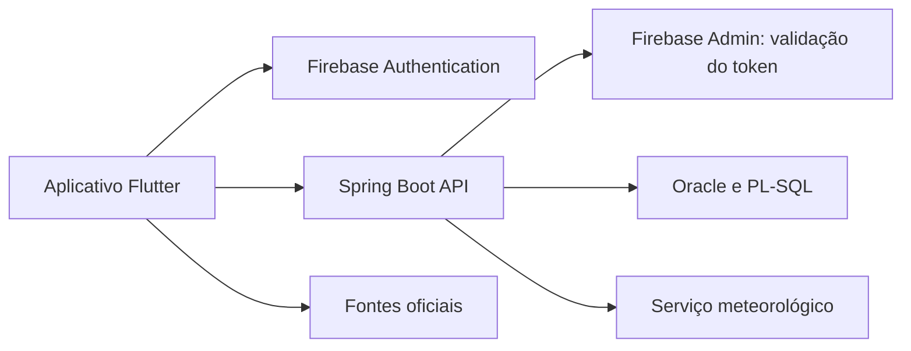

# Arquitetura da ELORA

## Visão geral

O Firebase autentica o usuário e preserva a sessão. O Flutter enviará o token de identidade à API Spring Boot. A API será responsável por validá-lo, associar o `uid` ao perfil Oracle e aplicar autorização em todas as operações.

O Oracle será a fonte dos registros, metas, checklists e indicadores consolidados. As rotinas em `database/oracle` automatizam operações relevantes sem realizar classificação clínica.

## Aplicativo

A organização por funcionalidade separa autenticação, cuidado, trabalho, ambiente, proteção, relatórios e assistente. Tema, modelos e componentes compartilhados ficam em `core`.

Controladores de texto e rolagem são descartados no `dispose`; listas longas devem usar construção incremental e paginação; sensores e localização não permanecem ativos em segundo plano. As telas respeitam tema claro/escuro e oferecem texto ampliado.

## Limites

- A ELORA fornece orientação educativa, sem diagnóstico ou triagem clínica.
- Alertas oficiais continuam sendo responsabilidade dos órgãos competentes.
- A assistente atual utiliza respostas determinísticas revisáveis.
- Integrações externas devem exibir fonte e horário de atualização.
